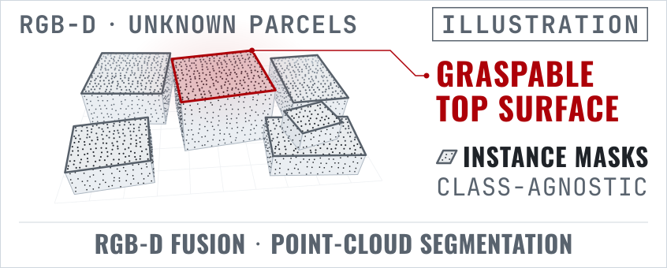
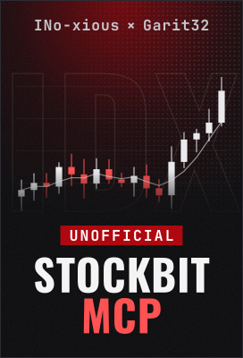
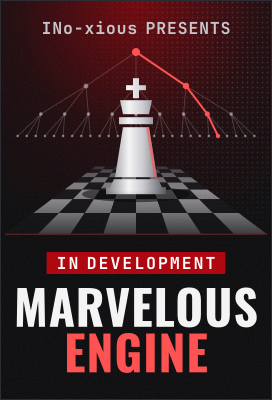
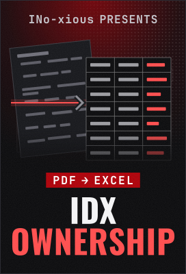

<!--
  Profile README for github.com/INo-xious. Art in ./assets is generated by tools/gen.py:
    python3 tools/gen.py
  Lettering is outlined to paths; the SVGs load nothing external.
  Manual upkeep:
  - Delete "(draft)" after Pinocchio #2959, #2960 and #2961 when each PR leaves draft.
  - A PR closed without merging turns its badge red; remove or re-label that line, and check the Credits rows that cite it.
  - The chess engine links to the dev branch; once dev is merged to main, switch the three links to the repo root and drop "in development on the `dev` branch". If the engine is no longer in development after the merge, also change the "IN DEVELOPMENT" pill and "in development" title in tools/gen.py (poster_engine), rerun gen.py, and edit the poster's alt text.
  - "since July 2026" (iCOM GIKKEN) and "since April 2026" (Ri-one) stay true until a role ends; edit them then, along with the Japanese line under the hero and the 自己紹介.
-->

**Marvel Harisson**, engineering student at Ritsumeikan University in Osaka (ISSE, B.Eng. 2026–2030). 
R&D Systems Engineer intern at **iCOM GIKKEN** since July 2026, working on robot perception for parcel picking. 
In my own projects I build a chess engine in C++ and, with [@Garit32](https://github.com/Garit32), an MCP server that connects AI agents to the Indonesian stock market. 
I'm interested in opportunities across the Kansai area.

立命館大学 情報理工学部 ISSEコースの学生です。 iCOM技研のインターンとして、荷物ピッキングロボットの認識技術に取り組んでいます。

[marvelharisson.com](https://marvelharisson.com) · [LinkedIn](https://www.linkedin.com/in/marvel-harisson/) · [im.marvel.harisson@gmail.com](mailto:im.marvel.harisson@gmail.com)

<b lang="ja">自己紹介</b> · Japanese self-introduction

 

はじめまして。Marvel Harisson です。インドネシアの高校を卒業後、2025年に東京の ARC Academy 日本語学校 新宿校で日本語を学び、2026年4月に立命館大学 情報理工学部 Information Systems Science and Engineering Course（ISSE）に入学しました（2030年卒業予定）。同月、日本学生支援機構（JASSO）の文部科学省外国人留学生学習奨励費に採用されました。英語とインドネシア語はネイティブレベルで、日本語は現在も勉強中です。

2026年7月からは、iCOM技研株式会社で R&D システムエンジニアのインターンとして、ロボットによる荷物ピッキングのための認識技術に取り組んでいます。未知の荷物の把持できる上面を検出するため、RGB-D フュージョンモデルと点群セグメンテーションモデルの学習と評価を行っています。また、未知の種類の荷物にも汎化できるよう、BlenderProc のドメインランダマイゼーションで生成した合成 RGB-D データで学習する、クラスに依存しないセグメンテーションのパイプラインも開発しました。

大学では、RoboCup に取り組むプロジェクト団体 Ri-one に所属し、@Home リーグのコンピュータビジョン（CV）チームで活動しています。RoboCup Japan Open 2026 では、同リーグの Bridge 部門で、チームとして Open Challenge 3位とポスター賞（Poster Award）を獲得しました。

そのほか、@Garit32 さんと共同開発している Stockbit MCP と、C++ で一から開発しているチェスエンジンを GitHub で公開しています。Stockbit MCP は、AI クライアントからユーザー自身の Stockbit アカウントを通じてインドネシアの株式市場の情報を扱える、非公式の MCP サーバーです。また、Pinocchio、supervision、Kornia、RAI の各オープンソースプロジェクトに、バグ修正のプルリクエストを送っています。

関西で働く機会に関心があります。ロボティクスやコンピュータビジョン、実用的なシステム開発に関するお話も歓迎します。お気軽にご連絡ください。

<h2><a href="https://www.linkedin.com/in/marvel-harisson/"><picture><source media="(prefers-color-scheme: dark)" srcset="assets/slate-01-in-production-dark.svg"></picture></a></h2>

<a href="https://www.linkedin.com/in/marvel-harisson/"><picture><source media="(prefers-color-scheme: dark)" srcset="assets/still-perception-dark.svg"></picture></a>

**iCOM GIKKEN** (iCOM技研) · R&D Systems Engineer, internship · since July 2026 
Perception for robotic parcel picking. I train and evaluate RGB-D fusion and point-cloud segmentation models that find the graspable top surfaces of unknown parcels. I also built a class-agnostic segmentation pipeline, trained on synthetic RGB-D data from BlenderProc domain randomization, to generalize to unseen parcel types. 
The still above illustrates the task. It is not company data or a real sensor frame.

**[Ri-one](https://github.com/Rione)**, Ritsumeikan's RoboCup team · @Home league, computer-vision team · since April 2026 
With Ri-one at RoboCup Japan Open 2026, in the @Home Bridge division: Open Challenge third place (bronze) and the Poster Award. My merged PRs to my teammates' ROS 2 workspaces: 
 [TurtleBot2.5 #2](https://github.com/Rione-at-Home/ros2_crane_and_turtle_ws/pull/2) · fixed Kobuki base timeouts by publishing velocity for the whole move 
 [Crane+ #3](https://github.com/Gil-gil-glitch/ros2_crane_plus_ws/pull/3) · initial and approach poses for picking up a can with the Crane+ arm 
 [Crane+ #6](https://github.com/Gil-gil-glitch/ros2_crane_plus_ws/pull/6) · place-left, place-right and catapult routines for the Crane+ arm GUI

**Ritsumeikan University**, Osaka Ibaraki Campus · B.Eng., Information Systems Science and Engineering (ISSE) · 2026–2030 
Monbukagakusho Honors Scholarship for Privately Financed International Students (JASSO), April 2026.

<h2><a href="https://github.com/INo-xious?tab=repositories"><picture><source media="(prefers-color-scheme: dark)" srcset="assets/slate-02-now-showing-dark.svg"></picture></a></h2>

<a href="https://github.com/INo-xious/stockbit-mcp"><picture><source media="(max-width: 1011px)" srcset="assets/poster-stockbit-mcp-thumb.svg"></picture></a>
<a href="https://github.com/INo-xious/marvelous-playstyle-engine/tree/dev"><picture><source media="(max-width: 1011px)" srcset="assets/poster-marvelous-engine-thumb.svg"></picture></a>
<a href="https://github.com/INo-xious/idx-ownership-data-pipeline"><picture><source media="(max-width: 1011px)" srcset="assets/poster-idx-pipeline-thumb.svg"></picture></a>

**[Stockbit MCP](https://github.com/INo-xious/stockbit-mcp)** · TypeScript · co-built with [@Garit32](https://github.com/Garit32) &nbsp; 
An unofficial MCP server, not affiliated with Stockbit or IDX, that gives Claude and other AI clients the Indonesian stock exchange through the user's own Stockbit account: quotes, broker flow, fundamentals and drawing on the user's real chart. It cannot place real-money orders, by design. Published on npm and in the official MCP Registry.

**[Marvelous engine](https://github.com/INo-xious/marvelous-playstyle-engine/tree/dev)** · C++20 · in development on the `dev` branch 
A chess engine I am writing from scratch: bitboard move generation, PVS search, NNUE evaluation and a UCI interface. I play chess, and the project started as an engine that learned my move choices from my own Chess.com games. It is for offline study and analysis, not for help during live games.

**[IDX ownership pipeline](https://github.com/INo-xious/idx-ownership-data-pipeline)** · Python 
Searches Indonesian Stock Exchange disclosures, downloads the PDFs and rebuilds their messy 5%-ownership tables into clean Excel workbooks, with a confidence score on every row. Playwright for scraping, pdfplumber for positional PDF parsing, a Streamlit UI, and tests on sanitized, fictional fixtures.

<b>More projects</b>

 

- **[Pac-Man agent](https://github.com/INo-xious/packman-game-ai-agent)** · Python. Plays a Processing Pac-Man game over TCP and JSON, planning routes that herd ghosts and chain power-pellet captures.
- **[Portfolio site](https://github.com/INo-xious/marvel-harisson)** · Next.js, TypeScript. The source of [marvelharisson.com](https://marvelharisson.com), with a spatial project map, a live Osaka clock, and English and 日本語 versions.

<h2><a href="https://github.com/search?q=is%3Apr+author%3AINo-xious+-user%3AINo-xious&amp;type=pullrequests"><picture><source media="(prefers-color-scheme: dark)" srcset="assets/slate-03-guest-appearances-dark.svg"></picture></a></h2>

Bug fixes I have proposed to robotics and computer-vision libraries. Each PR adds a regression test that fails without the fix, and each badge shows the PR's live state. [All my PRs to other repositories](https://github.com/search?q=is%3Apr+author%3AINo-xious+-user%3AINo-xious&type=pullrequests).

**[Pinocchio](https://github.com/stack-of-tasks/pinocchio)** · rigid-body dynamics for robots, C++ 
 [#2959](https://github.com/stack-of-tasks/pinocchio/pull/2959) (draft) · `buildReducedModel` failed with "several frames match" when a joint and a link shared a name 
 [#2960](https://github.com/stack-of-tasks/pinocchio/pull/2960) (draft) · `buildReducedModel` read past the end of the frame list when a locked joint had no frame; the PR proposes a clear error instead 
 [#2961](https://github.com/stack-of-tasks/pinocchio/pull/2961) (draft) · MJCF `connect` anchors on offset bodies were placed in the wrong frame

**[supervision](https://github.com/roboflow/supervision)** · Roboflow's computer-vision toolkit, Python 
 [#2639](https://github.com/roboflow/supervision/pull/2639) · `KeyPoints.with_nms()` crashed when filtering had removed every keypoint of a skeleton 
 [#2640](https://github.com/roboflow/supervision/pull/2640) · LabelMe export and import split one multi-part mask into several objects 
 [#2641](https://github.com/roboflow/supervision/pull/2641) · the LabelMe, YOLO and Pascal VOC exporters crashed on in-memory grayscale (2-D) images

**[Kornia](https://github.com/kornia/kornia)** · differentiable computer vision on PyTorch 
 [#5092](https://github.com/kornia/kornia/pull/5092) · PLY point-cloud save and load rejected `pathlib.Path` filenames

**[RAI](https://github.com/RobotecAI/rai)** · an agent framework for robots on ROS 2 
 [#876](https://github.com/RobotecAI/rai/pull/876) · the robot's "who am I" documentation service never replied, because the ROS 2 message rejected FAISS's NumPy float scores

<h2><a href="https://marvelharisson.com/about"><picture><source media="(prefers-color-scheme: dark)" srcset="assets/slate-04-credits-dark.svg"></picture></a></h2>

- **Perception** · RGB-D fusion, point-cloud segmentation, BlenderProc synthetic data · *at iCOM GIKKEN*
- **Vision** · supervision, Kornia (PyTorch), NumPy · *in PRs to supervision and Kornia*
- **Robotics** · ROS 2 (Humble, Jazzy), TurtleBot2 (Kobuki), Crane+ arm · *with Ri-one, and in a PR to RAI*
- **Systems** · C++20, bitboards, PVS search, NNUE, PGO builds · *in [Marvelous engine](https://github.com/INo-xious/marvelous-playstyle-engine/tree/dev)*
- **Agent tooling** · TypeScript, Node.js, MCP SDK, zod, GitHub Actions · *in [Stockbit MCP](https://github.com/INo-xious/stockbit-mcp)*
- **Data** · Python, Playwright, pdfplumber, pandas, Streamlit, pytest · *in [IDX ownership pipeline](https://github.com/INo-xious/idx-ownership-data-pipeline)*
- **Web** · Next.js, TypeScript, Tailwind CSS · *in my [portfolio site](https://github.com/INo-xious/marvel-harisson)*

**Contact.** I'm open to learning opportunities, collaborations, project feedback and conversations about software engineering, robotics and practical systems. 
[im.marvel.harisson@gmail.com](mailto:im.marvel.harisson@gmail.com) · [LinkedIn](https://www.linkedin.com/in/marvel-harisson/) · [marvelharisson.com](https://marvelharisson.com)

<b>Languages, earlier education and math awards</b>

 

- **Languages:** English and Indonesian (native); Japanese and Malay (limited working); Chinese, Javanese and Sundanese (elementary).
- **Before Ritsumeikan:** Japanese at ARC Academy Japanese Language School, Shinjuku (2025). Graduated from Sekolah Dian Harapan Daan Mogot, Indonesia (2025).
- **Math awards before university:** Asia International Math Olympiad silver, SEAMO bronze, Singapore Math Challenge (Global Finals) gold, ICAS Mathematics distinction (top 2%).

